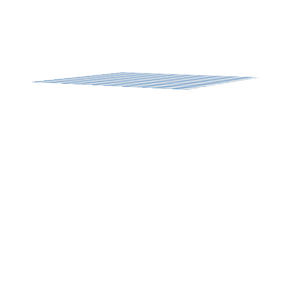

# Framework for inverse animation editing based on differentiable simulation
This is my Bachelor's thesis. The aim was to develop a tool for Unity which allowed the estimation of various simulation parameters within Unity.
It includes a differentiable physics engine built from scratch in C++, a Python module that does the optimizing using backpropagation to calculate the gradient of the loss function and a Unity project to display the results.

The framework is able to generate a simulation with some parameters for the mass and stiffness of a cloth and use numerical optimization combined with differentiable simulation and the backpropagation algorithm to guess those parameters based on the position of that simulation over many frames.

# Building
Requirements: CMake >= 3.18, a C++17 compiler and, for the Python module, Python 3 with development headers. Works on Linux, Windows and macOS.

    cmake -S . -B build -DCMAKE_BUILD_TYPE=Release
    cmake --build build -j

Build artifacts:

* `build/python/DifferentiablePhysicsEngine` — Python module. Add `build/python` to `PYTHONPATH` (or copy the file next to your script) and `import DifferentiablePhysicsEngine`.
* `build/unity/(lib)DifferentiablePhysicsEngine.(so|dll)` — Unity native plugin, also copied automatically into `UnityProject/Assets/`.

CMake options: `-DDPE_BUILD_PYTHON=OFF` (skip Python module, no Python headers needed), `-DDPE_BUILD_UNITY_BRIDGE=OFF` (skip Unity plugin).

Python dependencies for the optimizer:

    python -m pip install -r requirements.txt
